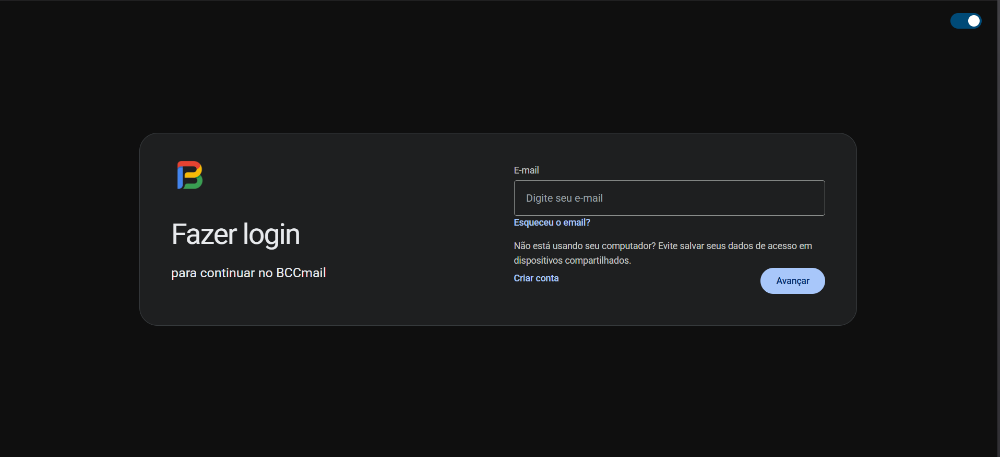
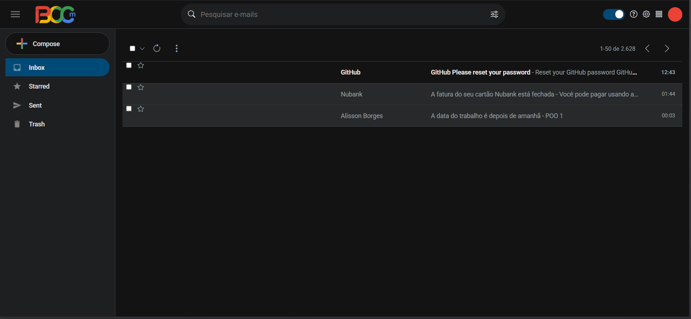
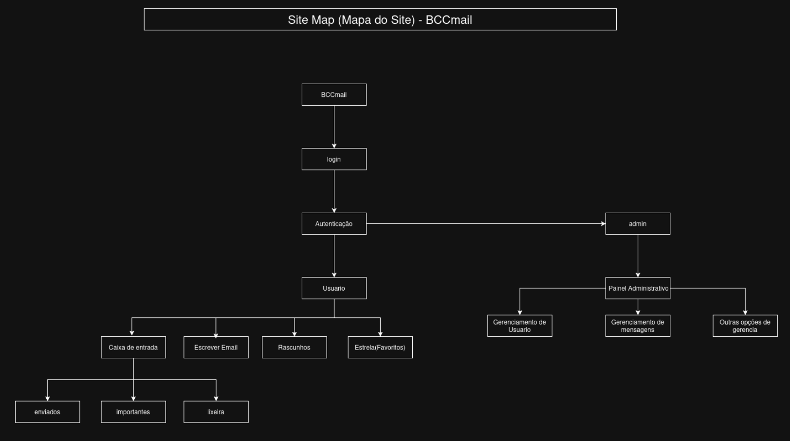

# BCCmail
**Disciplina:** Desenvolvimento Web I
**Tema:** Clone do Gmail (Webmail)  
**Arquitetura Base:** HTML5, CSS3/Bootstrap, JavaScript Vanilla (ES6), PHP Procedural/Modular com PDO + MariaDB
**Integrantes:** Alan Oliveira, Gabriel Barreto, Bruno Reis

## Sobre o Projeto:
- O BCCmail é um projeto acadêmico desenvolvido como parte da disciplina de Desenvolvimento Web I. A proposta consiste na criação de um sistema de webmail inspirado no Gmail, reproduzindo algumas de suas principais funcionalidades de navegação, organização e gerenciamento de mensagens.
- O projeto tem como objetivo aplicar conhecimentos de desenvolvimento web, validação de formulários, programação no lado do servidor e armazenamento de dados em banco de dados.


## Funcionalidades Principais - BCCmail
- Login de usuários por e-mail e senha.
- Visualização das mensagens recebidas na Caixa de Entrada.
- Consulta das mensagens enviadas.
- Marcação de mensagens como importantes.
- Leitura de e-mails.
- Envio de mensagens para usuários cadastrados.
- Armazenamento de mensagens não enviadas em Rascunhos.
- Gerenciamento de mensagens excluídas na Lixeira.
- Painel administrativo.


## Regras de Negócio

**Regra 1: Validação do destinatário e salvamento automático em Rascunhos**
Antes de enviar uma mensagem, o sistema deverá verificar se o endereço de e-mail informado possui um formato válido e se o destinatário está cadastrado no sistema. Caso o endereço seja inválido ou não exista, o envio será bloqueado, a mensagem será salva automaticamente em *Rascunhos* e o usuário será informado sobre o problema.

**Regra 2: Limite de armazenamento por usuário**
Cada usuário poderá armazenar no máximo 50 mensagens. Quando estiver próximo desse limite, o sistema deverá exibir um aviso. Ao atingir a quantidade máxima, novos envios serão bloqueados até que o usuário libere espaço, excluindo mensagens e esvaziando a *Lixeira*.


## Como executar o projeto
### Requisitos
- Docker
- Docker Compose

### Inicialização

1. Clone o repositório.
2. Abra a pasta do projeto no terminal.
3. Execute:

\```bash
docker compose up -d --build
\```

4. Acesse primeiro o setup e depois o sistema:

- http://localhost:8082/setup
- http://localhost:8082/

5. Para acessar o phpMyAdmin:

http://localhost:8081
\```

## Estrutura do Projeto

```text
BCCmail/
├── configs/
├── css/
├── img/
│   └── screenshots/
├── js/
├── src/
│   ├── controllers/
│   ├── core/
│   ├── models/
│   └── views/
├── Dockerfile
├── docker-compose.yml
└── README.md
```

## Telas do Projeto

### Login


### Caixa de entrada


### Diagrama Mapa do Site
